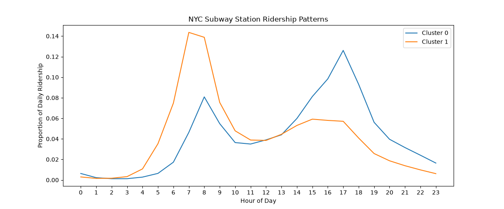
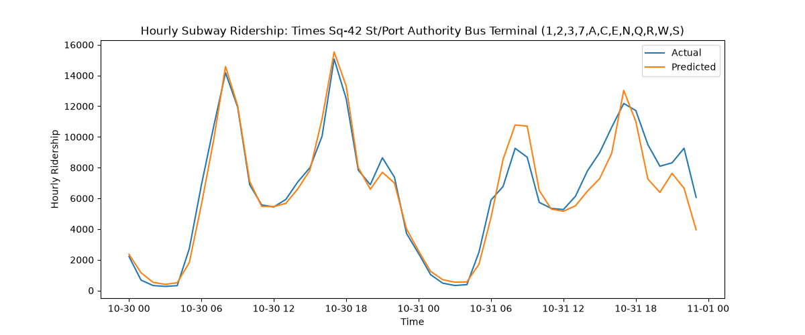

# NYC MTA Subway Ridership Analysis

Analyzes NYC subway ridership using MTA open data, MongoDB, and machine learning.

Uses K-Means clustering to identify stations with similar ridership patterns and a neural network to predict hourly ridership based on historical data.

---

### Dataset

Data is retrieved from the [MTA Subway Hourly Ridership](https://data.ny.gov/Transportation/MTA-Subway-Hourly-Ridership-Beginning-2025/5wq4-mkjj/about_data) dataset.

* **Period:** October 20–31, 2025
* **Stored data:** 120,398 records of hourly ridership by station
* **Clustering:** 424 station complexes analyzed using data from October 28, 2025
* **Forecasting:** 109,007 records with available previous-hour and previous-day ridership
* **Time handling:** Timestamps stored in UTC and converted to New York time for analysis

### Technologies Used

* **Language:** Python
* **Data processing:** Pandas, NumPy
* **Database:** MongoDB Atlas, PyMongo
* **Machine learning:** scikit-learn
* **Visualization:** Matplotlib
* **Testing:** pytest, GitHub Actions

---

### Current Features

#### Data Collection and Preprocessing
* Retrieves subway ridership data using pagination and configurable date ranges
* Removes invalid records, converts numeric values, and standardizes timestamps
* Saves cleaned data to local CSV files
* Collects and processes multiple days of ridership data

#### Data Storage
* Stores subway ridership data in MongoDB Atlas
* Combines records for the same station and hour into total hourly ridership using Pandas
* Uses unique indexes and upserts to prevent duplicate records
* Keeps hourly ridership data separate for each station and date

#### Ridership Analysis
* Calculates total ridership for each station
* Identifies the ten stations with the highest recorded ridership

#### Testing
* Uses pytest to test:
  * **Data preprocessing:** Handling negative ridership, missing data, numeric and timestamp conversions, and invalid timestamps
  * **Station feature creation:** Correct hourly ridership values and handling missing hours
  * **Ridership normalization:** Correct hourly proportions and removal of stations with zero ridership
  * **Data collection:** Correct date filtering and API request parameters
  * **Data aggregation:** Correct station-hour totals and preservation of total ridership
* Uses GitHub Actions to automatically run tests whenever code is pushed or a pull request is opened

---

### K-Means Clustering

* Creates 24-hour ridership profiles for 424 station complexes
* Converts hourly ridership into proportions of each station's daily total
* Compares different numbers of clusters using silhouette scores and inertia
* Uses K-Means to group stations with similar hourly ridership patterns
* Plots the average hourly ridership proportions for each cluster

The analysis identified two main groups: one with higher morning ridership and one with higher evening ridership.

This graph shows the average hourly ridership pattern for each cluster, based on data from October 28, 2025.

---

### Neural Network Forecasting

* Creates features using the hour, day of week, previous-hour ridership, and previous-day ridership
* Uses one-hot encoding for station IDs and scales numerical features
* Trains a neural network using scikit-learn's `MLPRegressor`
* Trains the model on earlier dates and tests it on later dates
* Evaluates predictions using Mean Absolute Error (MAE) and Root Mean Squared Error (RMSE)
* Compares the neural network against a baseline that predicts ridership using the same hour from the previous day

#### Model Configuration

* **Neural network:** MLPRegressor with one hidden layer (100 neurons)
* **Maximum training iterations:** 300
* **Training records:** 88,952
* **Testing records:** 20,055
* **Testing period:** October 30–31, 2025

#### Forecasting Results

| | Neural Network | Previous-Day Baseline |
|-|---:|---:|
| MAE | 66.66 | 78.52 |
| RMSE | 191.16 | 257.12 |

The neural network reduced MAE by about **15.1%** and RMSE by about **25.7%** compared with the previous-day baseline on the test data.

This graph compares actual hourly ridership with the neural network's predictions at Times Square on October 30–31, 2025. The evaluation results above are calculated using all 20,055 testing observations, not just Times Square.

---

### Limitations & Future Improvements

* The forecasting model was trained on a short period of data, so its performance may differ across longer periods
* The model uses actual ridership from previous hours and days rather than predicting multiple future days without new observations
* The neural network reached its maximum number of training iterations before fully converging
* The clustering analysis uses data from a single day

Future improvements include collecting more historical data, comparing clustering results across multiple days, trying different forecasting models, and improving model evaluation.
